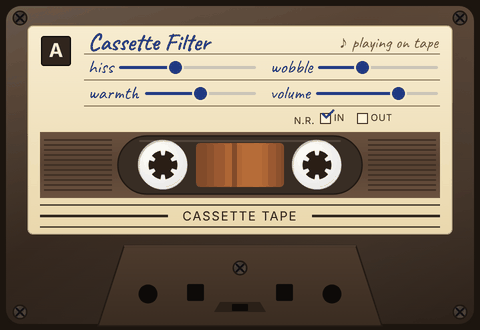
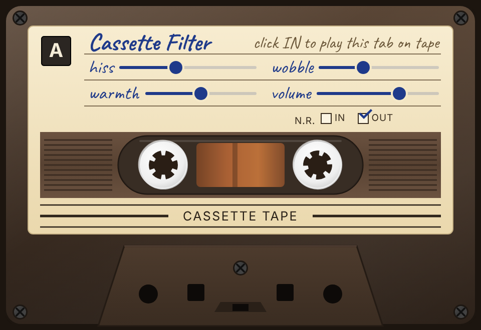
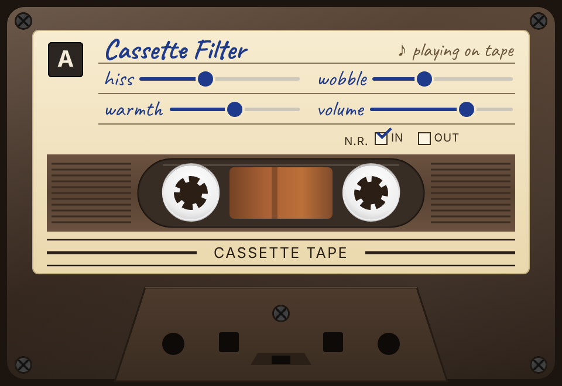
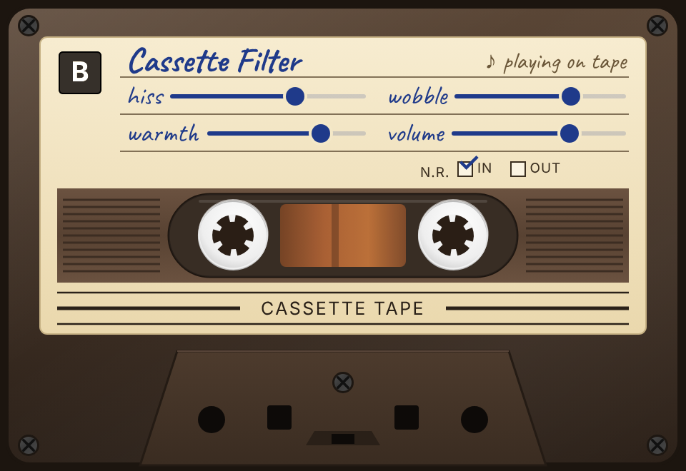

# Cassette Tape 📼

A Chrome extension that makes any tab sound like it's playing from an old cassette:
warm, slightly muffled, a little wobbly, with soft tape hiss underneath.

It works on YouTube, Spotify Web, SoundCloud, Apple Music on the web, or any other site that plays audio.



---

## What it does to the sound

| Effect | What you hear | Real cassette cause |
|---|---|---|
| **Warmth** | Highs roll off and loud parts get gently rounded | Tape loses high frequencies with age, and magnetic tape soft-saturates when driven hard |
| **Wobble** | A slow, wavering drift in pitch (wow) plus a faint fast shimmer (flutter) | Uneven motor speed and stretched tape |
| **Hiss** | Soft background "shhh" that fades in with the music and out when it stops | Noise from the magnetic particles on the tape itself |
| **Distance** | The stereo image is narrowed and there's a small bass bump | Narrow tape tracks and the playback head's low-frequency "head bump" |
| **Wear** (side B) | Occasional brief volume dips and faint static ticks | Worn or flaking oxide on old tapes |

Everything runs locally in your browser. No audio leaves your computer.

---

## The controls

The whole interface is the cassette. Click the extension's icon to open it.



- **N.R. ☐ IN / ☐ OUT:** tick **IN** to start playing the current tab through the tape. Tick **OUT** to turn it off.
- **The "A" box:** click it to flip the tape.
  - **Side A** is a tape in good condition: subtle hiss and gentle wobble.
  - **Side B** is a well-worn tape: more hiss, more warble, duller highs, occasional dropouts and static.
  - Flipping sets the sliders to that side's preset, and you can adjust them afterwards.
- **Sliders on the label lines:**
  - **hiss:** how loud the tape hiss is.
  - **wobble:** how much the pitch wavers.
  - **warmth:** how muffled and saturated the sound is.
  - **volume:** overall output level.
- **The reels:** they spin up when sound is playing, coast to a stop when it pauses, and waver slightly with the wobble setting.

| Side A, playing | Side B, worn tape |
|---|---|
|  |  |

Your settings are remembered between sessions.

---

## Install (Chrome, Edge, Brave, Arc)

1. Unzip this folder somewhere you'll keep it, because the browser loads it from there.
2. Open `chrome://extensions` (or `edge://extensions`).
3. Turn on **Developer mode** (top-right toggle).
4. Click **Load unpacked** and select the unzipped folder.
5. Pin **Cassette Tape** to the toolbar using the puzzle-piece icon.

**To use it:** play something in a tab, click the cassette icon, and tick **IN**.

---

## Good to know

- **One tab at a time.** Ticking IN on a different tab moves the tape there.
- **One audio extension per tab.** Chrome only lets one extension capture a tab's audio at once, so turn off any other audio extension (such as Lecture Audio Cleaner) on that tab first.
- **Chrome's own pages can't be captured.** That includes `chrome://` pages and the Web Store.
- **Volume controls still work.** The site's own volume slider still applies, and the **volume** slider here adds or removes up to about 12 dB on top.
- **Audio lag is tiny,** a few hundredths of a second, so video stays in sync.

## Files

```
manifest.json      extension definition (Manifest V3)
popup.html/css/js  the cassette interface
background.js      starts/stops tab capture
offscreen.*        hidden page where the audio is processed
dsp.js             the tape effect chain (Web Audio)
tape-worklet.js    hiss, dropouts, static, and level metering
fonts/             Caveat handwriting font (SIL Open Font License, see Caveat-LICENSE.txt)
icons/, images/    toolbar icons and README pictures
```
